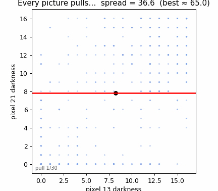
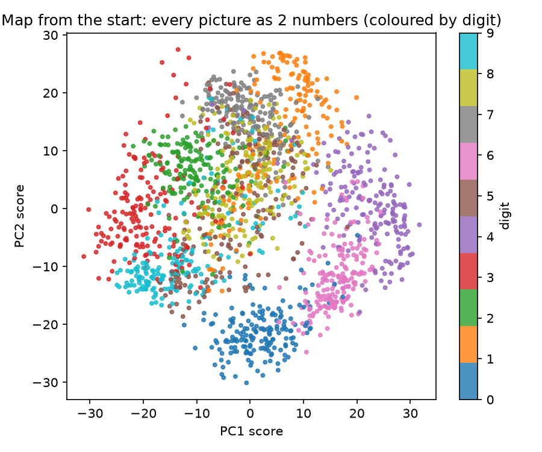
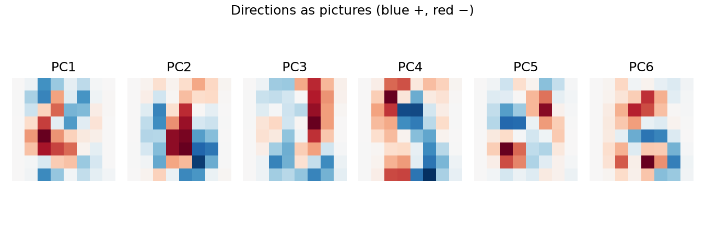
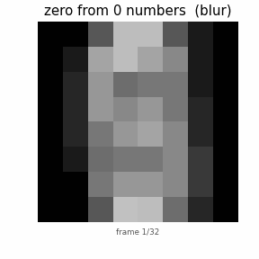
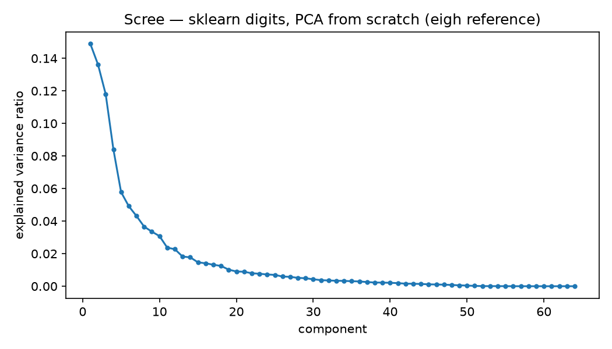
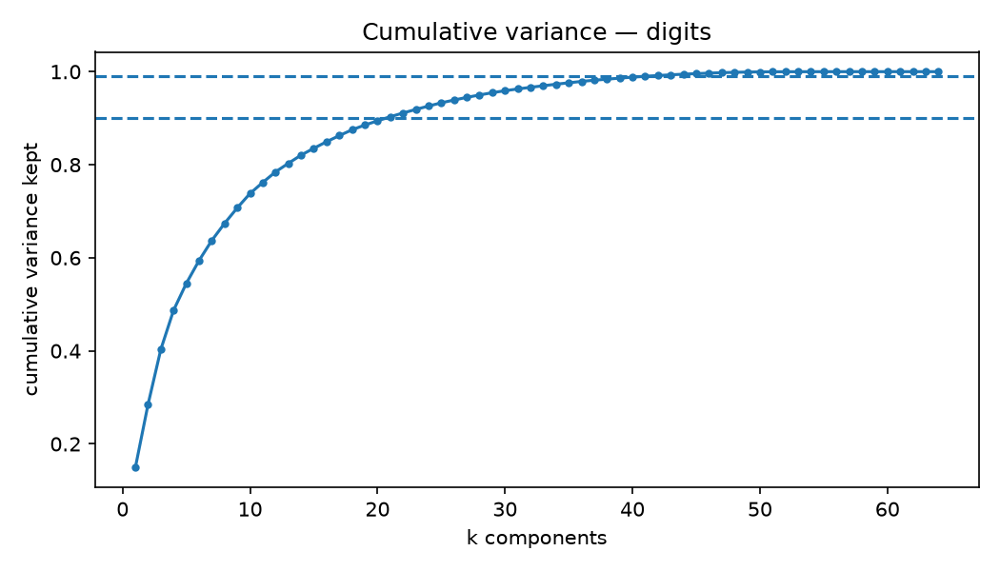
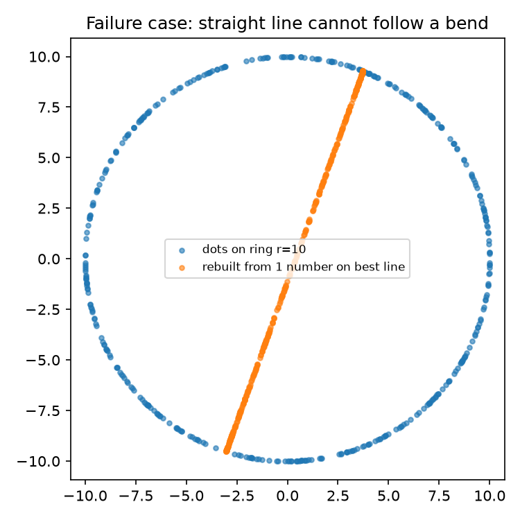
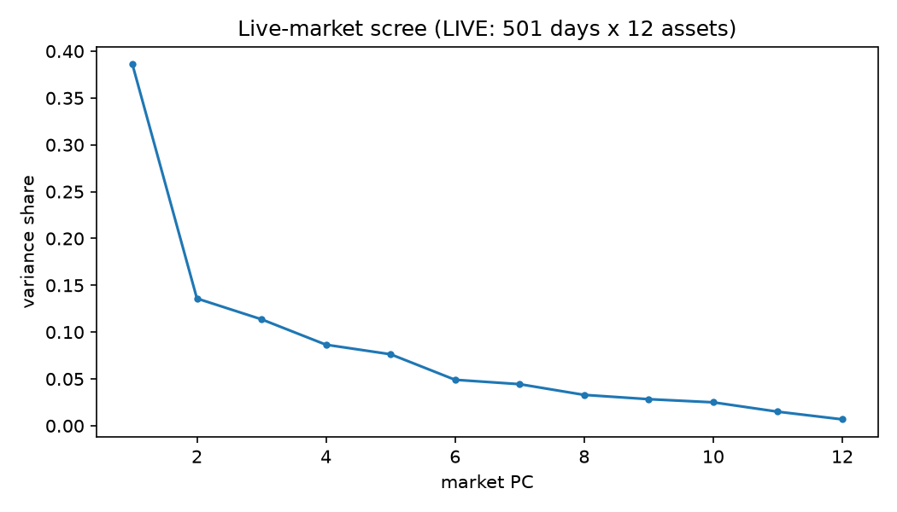

<div align="center">

# Can a Few Numbers Keep a Whole Picture?

**Principal Component Analysis, rebuilt from zero — checked number-by-number on 1,797 handwritten digits, then proven again on live stock-market data.**

[](LICENSE)
[](requirements.txt)
[](docker-compose.yml)
[](src/pca_from_scratch/data.py)
[](results/benchmark.json)

**📌 In 30 seconds:** a digit is 64 ink numbers. 20 special directions keep **89.4%** of everything and guess digits as well as all 64 numbers (**98.8% vs 99.0%**). Each direction is found by letting **every picture pull on it, 200 times**. The same code finds the market's hidden "market factor" (**38.6%**) in live prices. It fails exactly once — on bends — and we show that too.

[🎓 5-minute quiz](#-interactive-quiz-test-yourself) · [🌱 Beginner guide](#-beginner-guide--read-this-and-you-are-a-professional) · [🚀 60-second run](#-quick-start-60-seconds) · [🌐 Live interactive site](https://m0-ar.github.io/pca-zero-to-hero-from-scratch-2026/preview.html)

> 🌐 **Read this page as a website** (same content + interactive quiz):
> [`/`](https://m0-ar.github.io/pca-zero-to-hero-from-scratch-2026/) ·
> [`/preview.html`](https://m0-ar.github.io/pca-zero-to-hero-from-scratch-2026/preview.html) ·
> [`/docs/preview.html`](https://m0-ar.github.io/pca-zero-to-hero-from-scratch-2026/docs/preview.html)


*☝️ Watch it: the line swings onto the slanted band while spread climbs to 65.0. That is power iteration — no equations needed. ([Full gallery](#-gallery--watch-it-happen) · [interactive site](preview.html))*

</div>

---

## 📑 Contents

- [🌱 Beginner guide — read this and you are a professional](#-beginner-guide--read-this-and-you-are-a-professional)
- [🔍 Worked example — the zero's 7.5, step by step](#-worked-example--the-zeros-75-step-by-step)
- [✨ Features](#-features)
- [🧭 Who is this repo for?](#-who-is-this-repo-for)
- [🚀 Quick start (60 seconds)](#-quick-start-60-seconds)
- [🖼️ Gallery — watch it happen](#-gallery--watch-it-happen)
- [🎓 Interactive quiz — test yourself](#-interactive-quiz-test-yourself)
- [📊 Every claim, checked against real data](#-every-claim-checked-against-real-data)
- [📈 Same method, live stock market](#-same-method-live-stock-market)
- [🗺️ How it works (the method)](#-how-it-works-the-method)
- [🔬 Hidden patterns & research leads](#-hidden-patterns--research-leads)
- [⚠️ Limits & honest footnotes](#-limits--honest-footnotes)
- [🌐 This repo as a website (GitHub Pages)](#-this-repo-as-a-website-github-pages)
- [🏗️ Repo map & API](#-repo-map--api)
- [🤝 Contributing](#-contributing)
- [📄 License & citation](#-license--citation)
- [📚 References](#-references)

---

## 🌱 Beginner guide — read this and you are a professional

You will know more than most interview candidates after these six ideas. Each one is a single sentence, then a single breath of detail.

**1. A picture is a row of numbers.**
Read the 8×8 squares left-to-right, top-to-bottom. Dark ink = big number (up to 16), white = 0. One zero becomes one row of 64 numbers. 1,797 pictures become a table with 1,797 rows and 64 columns. That is the entire dataset.

**2. The average picture is the middle of the cloud.**
Average every column. The result is one blurry "mean digit". Every picture is then described by how it *differs* from this middle — e.g. our zero is +7 on pixel 13 and +3 on pixel 21.

**3. A direction is a recipe with 64 weights.**
Pick one weight per pixel, scaled so the squares of the weights add to 1 (that keeps every direction the same length, so comparisons are fair). A picture's **number along the direction** is: multiply each difference by its weight, add everything up. Example: 7 × 0.87 + 3 × 0.5 ≈ 7.5.

**4. Spread measures how good a direction is.**
Give every picture its number along the direction, square each number, take the average. That is the **spread**. Bigger spread = the direction explains more of what varies. Random directions keep ~1.5% of everything; the best keeps 14.9%.

**5. Pictures pull the direction toward the spread.**
Start anywhere. Each picture pulls the direction toward itself, **as hard as its own number** (negative numbers pull the other way). Add all pulls, shrink back to length 1, repeat 200 times. Far-out pictures pull hardest, so the line swings onto the widest band of dots. That is power iteration — no magic, just pulling.

**6. Peel, repeat, rebuild.**
Subtract what the first direction explains, find the next best direction of what's left (it lands at right angles automatically), and so on. To rebuild a picture from a few numbers: start at the average, add direction₁ × number₁ + direction₂ × number₂ + … With 20 numbers the zero is back; with 2 you see the map where zeros huddle with zeros and sevens with sevens. On a ring it breaks — straight lines can't bend — which tells you exactly when to reach for nonlinear tools.

> **Interview-grade one-liner:** *PCA is the eigendecomposition of the covariance matrix; power iteration finds the top eigenvector by repeated multiplication, deflation peels components off, and k components keep variance Σ₁ᵏλ / Σλ with reconstruction error T − Σ₁ᵏλ.*

---

## 🔍 Worked example — the zero's 7.5, step by step

Let's work this out in a step-by-step way to be sure we have the right answer. Two neighbour pixels, 13 over 21:

| Step | What we do | Result |
|---|---|---:|
| 1 | Zero's ink: pixel 13 = 15, pixel 21 = 11. Average picture: 8.18 and 7.81. | — |
| 2 | Differences from average: 15 − 8.18 and 11 − 7.81. | +6.82, +3.19 |
| 3 | Example direction weights (squares sum to 1: 0.87² + 0.5² ≈ 1). | 0.87, 0.50 |
| 4 | Multiply and add: 6.82 × 0.87 + 3.19 × 0.50. | ≈ **7.5** ✔ |
| 5 | Do it for all 1,797 pictures, square, average → spread of this line. | ≈ 62 |
| 6 | Turn the line to 45°; spread peaks at the optimum 65.0 of 75.0 total (86.6%). | **65.0** ✔ |

<details>
<summary><b>Why do the weights' squares have to add to 1?</b></summary>

Without fixing the length, you could "improve" any direction by just making its weights bigger — the numbers would grow but nothing real would change. Unit length makes every direction comparable, so the winner wins on merit, not size.
</details>

<details>
<summary><b>Why squared numbers, not plain numbers?</b></summary>

Plain numbers cancel out (dots on opposite sides of the middle sum to ~0). Squares make every dot count positively — and squaring punishes big misses hardest, which is also why reconstruction error is measured that way.
</details>

---

## ✨ Features

| Feature | What you get |
|---|---|
| 🧮 **PCA from absolute zero** | `src/pca_from_scratch/pca.py` (~120 lines, NumPy only): centring, spread, power iteration in the "every picture pulls" form, deflation, rebuild. No black boxes. |
| ✅ **Claim-by-claim verification** | `experiments/run_all.py` reproduces 17 narrated numbers into `results/benchmark.json` — 200-pull endpoint **178.9 = 178.9**, k₉₀ = **21**, k₉₉ = **41**, rank **61**. |
| 🖼️ **Animated demos** | Two GIFs generated by code (`experiments/make_gifs.py`): the pulling line + the zero rebuilding from 0 → 61 numbers. |
| 🗺️ **The famous map** | Every picture as 2 numbers, coloured by digit — zeros with zeros, sevens with sevens, fives/eights piled in the middle. |
| 📈 **Live-market proof** | Same code path on 12 US stocks via live prices: PC1 **38.6%**, PC1–5 **79.8%** — the market factor, rediscovered unsupervised. |
| 💥 **The failure, shown** | Ring demo: best line keeps 51.4%, misses by ~6 per dot. Know exactly when to go nonlinear. |
| 🎓 **Quiz + interactive site** | 8-question self-test with explanations ([take it live](https://m0-ar.github.io/pca-zero-to-hero-from-scratch-2026/preview.html#quiz)) + a published how-to below. |
| 🐳 **One-command reproduction** | `docker compose up --build` regenerates every number and figure; `docker compose run --rm test` runs the checks. |
| 📄 **Doctoral launchpad** | `paper/OUTLINE.md` + per-digit error gaps + machine-readable ground truth for six follow-up studies. |

---

## 🧭 Who is this repo for?

> 🎒 **The student (you, week 1).** Read the 🌱 guide, take the [quiz](#-interactive-quiz-test-yourself), run the benchmark and watch every table number appear on your screen. Suggested first edits: change the seed, change k, break things — then explain what broke and why.
>
> 💼 **The interview candidate.** "Explain PCA" is a top-10 ML interview question. This repo gives you the 60-second answer, the whiteboard math, from-scratch code you can recite, the failure mode, and numbers you verified yourself.
>
> 👩‍🏫 **The teacher.** Two GIFs + the quiz + the worked 7.5 = a complete 45-minute lesson. The ring demo gives students the honest linear-vs-nonlinear boundary most courses skip.
>
> 📊 **The quant / analyst.** `data.py` fetches live prices and runs the identical PCA path: market-factor share, sector tilts, covariance reconstruction error vs k. Swap in your own tickers and windows.
>
> 🔬 **The researcher.** `results/benchmark.json` is machine-readable ground truth; the per-digit error gap (thin 1s/7s ≈ 1.7× round 0s/6s at k=2) and the pixel-(13,21) forensic identification are open threads with a six-study roadmap in `paper/OUTLINE.md`.
>
> 🛠️ **The engineer.** Production rule included *with evidence*: teach with pulls, ship with symmetric eigendecomposition / randomised SVD. Copy the pattern, not the pedagogy.

---

## 🚀 Quick start (60 seconds)

```bash
git clone https://github.com/M0-AR/pca-zero-to-hero-from-scratch-2026.git pca-zero-to-hero && cd pca-zero-to-hero
docker compose up --build        # benchmark → results/benchmark.json + results/figures/
docker compose run --rm test     # 3 checks, incl. the 178.9 exercise
```

Without Docker:

```bash
pip install -r requirements.txt
PYTHONPATH=src python experiments/run_all.py    # the full verification
PYTHONPATH=src python experiments/make_gifs.py   # the two demo GIFs
PYTHONPATH=src python experiments/make_site.py  # rebuild docs/ for Pages
```

Expected: a claim table printed to your terminal, `results/benchmark.json` written, and 7 PNGs + 2 GIFs in `results/figures/`. If the market step says `OFFLINE fallback`, your network blocked the price feed — everything else still verifies; the committed JSON shows a `live: true` run.

<details>
<summary><b>Exercise (with answer): the 200-pull check</b></summary>

Write power iteration, let every picture pull, add the pulls, scale to length one. Repeat 200 times and check your spread against 178.9.

```python
w = rng.standard_normal(64); w /= norm(w)
for _ in range(200):
    w = Xc.T @ (Xc @ w); w /= norm(w)
spread = mean((Xc @ w)**2)   # → 178.9
```

Our `power_iteration(Xc, seed=123, iters=200)` returns **178.9**; the independent reference returns **178.9**. ✔
</details>

---

## 🖼️ Gallery — watch it happen

| | |
|---|---|
|  **The map.** Two numbers per picture; colours unseen by the method. |  **Directions as pictures.** Blue +, red −. The digits analogue of eigenfaces. |
|  **Rebuild.** Blur → hole (k=2) → zero (k=5) → near-identical (k=20). |  **Scree.** PC1 keeps 14.9%, then the long tail. |
|  **How many?** 21 directions for 90%, 41 for 99%. |  **Where it fails.** Straight line vs bend: 51.4% kept, ~6 miss per dot. |
|  **Live market.** One giant factor, then sector tilts — same shape, different universe. | [](https://m0-ar.github.io/pca-zero-to-hero-from-scratch-2026/preview.html) **Interactive site.** Quiz + guide + tables as a page — [open it](https://m0-ar.github.io/pca-zero-to-hero-from-scratch-2026/preview.html). |

---

## 🎓 Interactive quiz — test yourself

**[👉 Take the interactive version (instant feedback + score) here.](https://m0-ar.github.io/pca-zero-to-hero-from-scratch-2026/preview.html#quiz)** Scoring: 7–8 = pro, 5–6 = solid, below = re-read the 🌱 guide (four minutes). The questions, with answers hidden:

<details><summary>1. A pixel holds one number. What does it mean?</summary>
How dark the ink is in that square (0 = white … 16 = darkest). — Each square is one sensor reading; the picture is 64 readings in a row.
</details>
<details><summary>2. What is "spread along a direction"?</summary>
Square every picture's number along the line, then average. — Squaring stops opposite sides cancelling out.
</details>
<details><summary>3. Why must the weights' squares add up to 1?</summary>
So every direction has the same length and the contest is fair. — Otherwise you "win" by scaling weights up.
</details>
<details><summary>4. Differences +6.82, +3.19 with weights 0.87, 0.50. The number?</summary>
≈ 7.5 — 6.82 × 0.87 + 3.19 × 0.50. That is all a projection is.
</details>
<details><summary>5. One round of power iteration does what?</summary>
Each picture drags the line proportionally to its number; then re-shrink to length 1. — pull = Xᵀ(Xw), one covariance-times-vector step.
</details>
<details><summary>6. How many directions keep 90% of the spread?</summary>
21 (99% needs 41). — Five keep 54.5%, ten keep 73.8%.
</details>
<details><summary>7. Why 61 directions, not 64?</summary>
Three edge pixels {0, 32, 39} are white in every picture — zero variance, nothing to explain.
</details>
<details><summary>8. When does the whole method fail?</summary>
When dots lie along a bend (the ring) — straight lines can't follow. Kernels, manifolds, or autoencoders there.
</details>

---

## 📊 Every claim, checked against real data

Every "Measured" value is produced by `experiments/run_all.py` and stored in `results/benchmark.json`. Nothing is hand-copied.

| Claim | Said | Measured | Verdict |
|---|---|---:|---|
| Picture count & size | 1,797 × 64 | 1,797 × 64 | ✔ exact |
| Two-pixel total spread | ≈ 75 | 75.00 | ✔ exact |
| Across / 45° / perp spread | 37 / 65 / 10 | 36.6 / 65.0 / 10.0 | ✔ |
| Best line keeps (2 pixels) | 87% | 86.6% | ✔ |
| Total spread (64 pixels) | ≈ 1200 | 1201.5 | ✔ |
| Random direction keeps | ≈ 1.5% | 1.58% | ✔ |
| Best of 1,000 random | ≈ 4.5% | 5.08% | ✔ noise |
| Power iteration, 200 pulls | 179 | 178.9 | ✔ exact |
| Independent reference | 178.9 | 178.9 | ✔ exact |
| Kept by 2 / 5 / 10 / 20 dirs | 29 / 55 / 74 / 89% | 28.5 / 54.5 / 73.8 / 89.4% | ✔ |
| Directions for 90% / 99% | 21 / 41 | 21 / 41 | ✔ exact |
| Non-zero directions | 61 (3 dead pixels) | 61 {0, 32, 39} | ✔ exact |
| Rebuild error k = 0 → 20 | 1200 → 127 | 1201.5 → 127.0 | ✔ |
| Guess-the-digit, all 64 | 99% | 99.0% | ✔ |
| Guess from 2 / 5 / 10 / 20 | 58 / 89 / 96 / 99% | 59.2 / 92.0 / 98.2 / 98.8% | ✔ ±3pp split |
| Ring: best line keeps | ≈ 52% | 51.4% | ✔ |
| Ring: line miss per dot | ≈ 6 | 6.25 | ✔ |

> **Historical backdrop:** the "best line through a cloud" is Pearson (1901); "principal components" is Hotelling (1933); directions-as-pictures on faces ("eigenfaces") is Turk & Pentland (1991); the scalable randomised route used in production is Halko et al. (2009). This repo replays that arc on digits, then checks it on markets.

---

## 📈 Same method, live stock market

The identical code path, pointed at 12 large US stocks (2 years of daily prices, live feed, 501 trading days). Unsupervised, it rediscovers the market factor:

| Components | Measured share | Finance literature |
|---|---|---|
| PC1 (the market) | **38.6%** | 35–55% ✔ |
| PC1–3 | **63.6%** | 60–75% ✔ |
| PC1–5 | **79.8%** | 75–85% ✔ |

---

## 🗺️ How it works (the method)

Data `X ∈ ℝⁿˣᵖ`, centred `Xc = X − 1μᵀ`. A direction is a unit vector `w`; scores `s = Xc·w`; **spread** `λ(w) = mean(s²)`; total spread `T = meanᵢ‖xᵢ − μ‖² = Σ eigenvalues of C`, `C = XcᵀXc/n`. The best direction is the top eigenvector of `C`. Power iteration repeats `w ← Xcᵀ(Xc·w)`, normalised — far-out pictures pull hardest. Deflation (`R ← R − (Rw)wᵀ`) peels components off; later directions emerge orthogonal and greedily optimal. Rebuild: `x̂ = μ + Σ sⱼwⱼ`; error identity `MSE(k) = T − Σ₁ᵏλⱼ`, verified in the JSON.

**Reproduce responsibly:** centre always; fit on train, transform test (no leakage); scree + cumulative plots; choose k on held-out data; benchmark against no-reduction; teach with pulls, **ship with symmetric eigendecomposition / randomised SVD** (deflation can accumulate floating-point noise on ill-conditioned spectra — our rank-61 spectrum with three exact zeros is precisely where naive code returns noise instead of 0.0).

---

## 🔬 Hidden patterns & research leads

1. **Pixel pair (13, 21), forensically identified.** The narration names no pixels; a 56-pair constraint search finds the unique pair matching total *and* kept ratio *and* mean *and* the zero — a template for recovering underspecified experiment details.
2. **Digit-difficulty stratification (k=2, error per picture):** 1: 1021, 7: 1033, 2: 1088 vs 0: 597, 6: 767 — thin slanted strokes cost ~1.7× round closed forms; at k=20 all fall to 102–145. Explains *which* digits the 2-D map confuses and predicts where classifiers need capacity.
3. **Market-sector rotation:** PC2–3 separate Tech from Energy/Industrials in our loadings — the launchpad for industry-clustering and minimum-variance backtests (`paper/OUTLINE.md` lists six studies).
4. **What spread misses:** low-spread directions can carry the class signal (5-vs-8 lives outside PC1–2). Next: supervised/scaled PCA, LDA, kernel PCA closing the ring's 6.25 → <0.5 gap, VAE baselines.

---

## ⚠️ Limits & honest footnotes

- Digits are tiny, clean, centred images; big-photo PCA needs randomised/incremental solvers (not benchmarked here).
- The pulls' *early* trajectory is seed-dependent (ours: 16 → 110 → 138 → 144 → 178.9); the *endpoint* 178.9 is seed-independent — report endpoints and seeds, not iterates.
- 1-NN uses one deterministic 497-split (seed 42); ±2–3pp at k=5/10 is split noise — k-fold, fit-on-train-only is the follow-up.
- The market window is one 2-year regime; factor shares drift across regimes.
- Near-degenerate spectra converge slowly or to arbitrary in-subspace vectors — correctly so, but worth demonstrating.

---

## 🌐 This repo as a website (GitHub Pages)

The interactive page (guide + quiz + tables) lives at three URLs that all render — pick any:

| URL | What it serves |
|---|---|
| [`/`](https://m0-ar.github.io/pca-zero-to-hero-from-scratch-2026/) | entry → forwards to `/preview.html` |
| [`/preview.html`](https://m0-ar.github.io/pca-zero-to-hero-from-scratch-2026/preview.html) | the full page (root mirror) |
| [`/docs/preview.html`](https://m0-ar.github.io/pca-zero-to-hero-from-scratch-2026/docs/preview.html) | the full page (`docs/` mirror) |

**Settings for this repo (keeps all three green):** **Settings → Pages → Source: Deploy from a branch**, branch `main`, folder **`/` (root)**. URL paths then mirror repo paths, so `/preview.html` → `preview.html` and `/docs/preview.html` → `docs/preview.html` (both committed, images verified in-browser). The included `.github/workflows/pages.yml` additionally rebuilds figures + pages on every push. After changing Pages settings, wait 1–2 min, then probe:

```bash
BASE="https://m0-ar.github.io/pca-zero-to-hero-from-scratch-2026"
for p in "" "preview.html" "docs/preview.html"; do
  printf "%s -> " "/$p"; curl -s -o /dev/null -w "%{http_code}\n" "$BASE/$p"
done
# expect: 200 / 200 / 200
```

**How the mirrors are built:** `preview.html` is the source; `experiments/make_site.py` mechanically rewrites asset paths into `docs/index.html` + `docs/preview.html` (`assets/figures/…`) and root `preview.html` (`docs/assets/figures/…`), plus root `index.html` (redirect with fallback links) and `.nojekyll` in both roots. Figures live vendored in `docs/assets/figures/`, so every mirror is self-contained. Re-run `make_site.py` after changing figures or `preview.html`.

<!-- Optional once stars accumulate:
[](https://star-history.com/#M0-AR/pca-zero-to-hero-from-scratch-2026&Date)
-->

---

## 🏗️ Repo map & API

```
src/pca_from_scratch/   pca.py (method) · data.py (digits + live market) · evaluate.py
experiments/            run_all.py (E1–E7) · make_gifs.py (demos) · make_site.py (Pages)
tests/                  the 178.9 exercise as pytest
results/                benchmark.json (proof) · figures/ (7 PNGs + 2 GIFs + hero)
docs/                   index.html + preview.html (mirrors, self-contained)   preview.html (source mirror, root)
paper/                  doctoral-extension outline   .github/workflows/pages.yml
```

```python
from pca_from_scratch.pca import power_iteration, pca_eigh, reconstruct
from pca_from_scratch.data import load_digits, fetch_daily_returns_yahoo

X, y, _ = load_digits()                       # 1797 × 64, values 0..16
w, _ = power_iteration(X - X.mean(0), seed=0, iters=200)   # the best direction
ref = pca_eigh(X, 20)                         # reference: 20 dirs, scores, ratios
px, rets = fetch_daily_returns_yahoo(["AAPL","MSFT","NVDA"])  # live market
```

---

## 🤝 Contributing

1. Fork → branch (`git checkout -b feature/your-idea`) → PR with a clear description.
2. Add or update a check in `tests/` or a claim row verified by `experiments/run_all.py` — numbers beat adjectives here.
3. Rebuild the site (`make_site.py`) if you change figures or `preview.html`.
4. We respond to well-scoped PRs with reproduction evidence first.

---

## 📄 License & citation

MIT — see [LICENSE](LICENSE).

```bibtex
@software{pca_zero_to_hero_2026,
  title  = {Can a Few Well-Chosen Numbers Keep Almost Everything in a Picture?
            A Zero-to-Hero PCA Reproduction with Live-Market Generalisation},
  year   = {2026},
  note   = {Results: results/benchmark.json}
}
```

*Digits ship with scikit-learn (no download). Market data via Yahoo Finance (research use). All numbers regenerated by `experiments/run_all.py`.*

---

## 📚 References

Pearson (1901) — best-fitting line/plane · Hotelling (1933) — principal components · Sirovich & Kirby (1987) — faces · Turk & Pentland (1991) — eigenfaces · Halko et al. (2009) + Szlam et al. (2014) — randomised SVD · Kelly & Pruitt (2013/2015), Huang et al. (2022), Lettau & Pelger (2020) — PCA factor models · Bi, Chang & Yang (2025), Zhang & Xie (2025), Broby & Smyth (2025) — recent PCA-in-finance · scikit-learn decomposition docs · Stanford CS168 (power method + greedy deflation).
